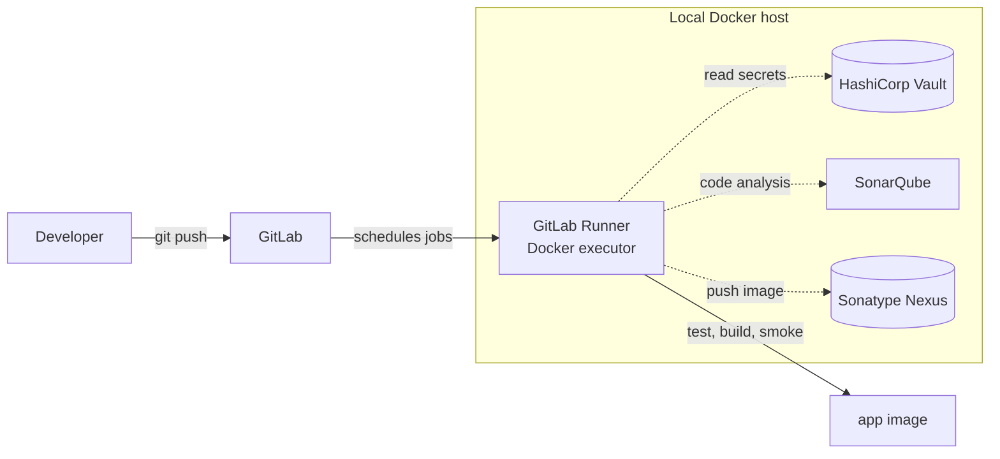

# DevSecOps Pipeline

A hands-on build of an "all-inclusive" GitLab CI/CD setup: a small FastAPI service shipped through a pipeline that adds secret management, code quality gates, security scanning, and a private artifact registry.

The project replicates the setup from the lecture **"All-inclusive CI/CD resort: HashiCorp Vault, SonarQube, Nexus and free SAST/DAST spa"**, step by step, on a local self-hosted runner.

## Goal

Each tool answers a question that every production pipeline has to solve:

| Question | Tool | Status |
|----------|------|--------|
| Where do secrets live, if not in git? | HashiCorp Vault | In progress |
| Does the code meet quality standards? | SonarQube | Planned |
| Does the source contain vulnerable patterns? | GitLab SAST | Planned |
| Can the running application be attacked? | DAST | Planned |
| Where are Docker images and other artifacts stored? | Sonatype Nexus | Planned |
| How are releases versioned? | Semantic Versioning | Planned |

## Roadmap

- [x] FastAPI service with a health endpoint and tests
- [x] Multi-stage, non-root Docker image
- [x] Self-hosted GitLab Runner with the Docker executor
- [x] Pipeline: test → build → smoke test
- [x] Vault in server mode with persistent file storage
- [ ] Initialize and unseal Vault
- [ ] KV v2 secrets engine, access policies, and a limited-scope token role
- [ ] Read secrets from Vault in CI jobs
- [ ] SonarQube server and a `sonar-scanner` job that waits for the quality gate
- [ ] GitLab SAST template in the pipeline
- [ ] DAST scan against the running container
- [ ] Nexus as a private Docker registry, with images tagged by semantic version

## Architecture



Solid lines work today. Dashed lines are planned.

## Repository layout

```
.
├── .gitlab-ci.yml               # CI/CD pipeline
├── app/                         # FastAPI service, see app/README.md
└── infra/
    ├── docker-compose.yml       # GitLab Runner and Vault
    └── vault/
        └── config/vault.hcl     # Vault server configuration
```

`infra/runner-config/` is created when the runner is registered. It holds the runner token and is ignored by git.

## Prerequisites

- Docker with Docker Compose v2
- [uv](https://docs.astral.sh/uv/) to run the service locally
- A GitLab project to run the pipeline in

## Getting started

### 1. Run the service

See [app/README.md](app/README.md) for running the service locally, running tests, and building the image.

### 2. Start the GitLab Runner

```bash
cd infra
docker compose up -d gitlab-runner
```

Register the runner once. In GitLab, open **Settings → CI/CD → Runners → New project runner**, copy the token, and run:

```bash
docker compose exec gitlab-runner gitlab-runner register \
  --non-interactive \
  --url https://gitlab.com \
  --token <runner-token> \
  --executor docker \
  --docker-image alpine:latest \
  --docker-volumes /var/run/docker.sock:/var/run/docker.sock
```

The host Docker socket is mounted into jobs so they can build and run images without Docker-in-Docker. This gives jobs root-level access to the host, which is acceptable for a local learning setup but not for a shared runner.

### 3. Start Vault

```bash
cd infra
docker compose up -d vault
docker compose exec vault vault status
```

A fresh Vault reports `Initialized false` and `Sealed true`. The web UI is at <http://localhost:8200>.

Vault runs in **server mode**: data is encrypted and persisted in the `vault-data` volume, and Vault starts sealed after every restart until it is unsealed with a quorum of key shares. **Dev mode**, by contrast, keeps everything in memory, starts unsealed, and loses all data on restart, so it must never hold real secrets.

`vault operator init` prints the unseal keys and the initial root token. Never commit them, paste them into issues, or print them in CI logs.

## CI/CD pipeline

Defined in [`.gitlab-ci.yml`](.gitlab-ci.yml). Every push runs three stages:

| Stage | Job | What it does |
|-------|-----|--------------|
| `test` | `test_job` | Installs locked dependencies with `uv sync --locked` and runs `pytest`. |
| `build` | `build_job` | Builds the image as `app:$CI_COMMIT_SHORT_SHA`. |
| `smoke` | `smoke_job` | Starts the built image, polls `/health` with retries from a `curlimages/curl` container that shares its network, and removes the container afterwards. |

All jobs talk to the same Docker daemon through the mounted socket, so the image built in `build` is available to `smoke` without a registry. Pushing images to Nexus will replace this shortcut.

## Security practices

- **No secrets in git.** The runner token lives in a git-ignored directory, and `.env` files are excluded from the Docker build context.
- **Pinned infrastructure images.** GitLab Runner and Vault are pinned by version and digest, so a re-tagged image cannot be pulled silently.
- **Least privilege.** The application container runs as a non-root user, and the Vault configuration is mounted read-only.
- **Local-only plain HTTP.** Vault TLS is disabled because the listener is only reachable locally. Enable TLS before exposing it anywhere else.

## Repositories

- GitLab (primary, runs the pipeline): <https://gitlab.com/alibekn/devsecops-pipeline>
- GitHub (mirror): <https://github.com/alibekn6/devsecops-pipeline>

## References

- [HashiCorp Vault documentation](https://developer.hashicorp.com/vault/docs)
- [SonarQube documentation](https://docs.sonarsource.com/)
- [GitLab SAST](https://docs.gitlab.com/user/application_security/sast/)
- [Sonatype Nexus Repository documentation](https://help.sonatype.com/)
- [Semantic Versioning](https://semver.org/)
